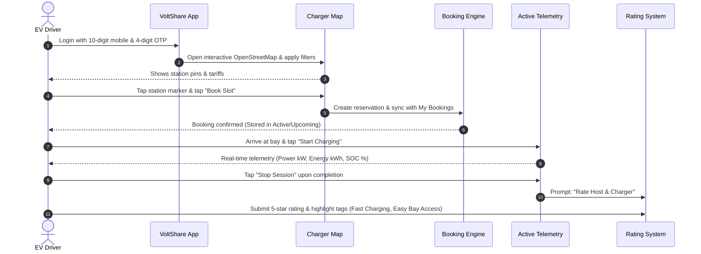
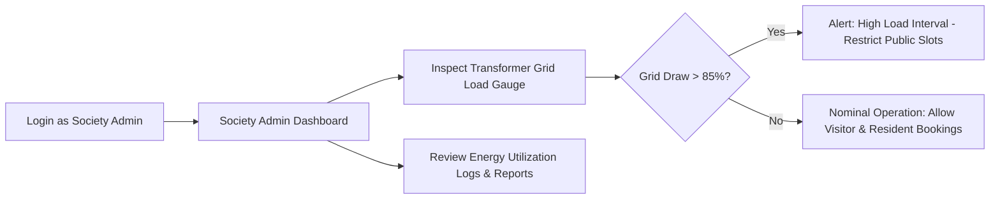
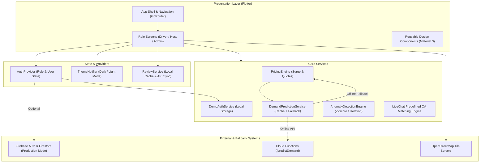

# VoltShare ⚡

> **Peer-to-Peer EV Charging & Residential Energy Marketplace**  
> *Democratizing EV charging across India by turning idle residential wallboxes into an intelligent, community-powered charging network.*

[](https://flutter.dev)
[](https://dart.dev)
[](https://github.com/jahnavireddy18/Voltshare/actions/workflows/build_apk.yml)
[](https://github.com/jahnavireddy18/Voltshare/actions/workflows/build_web.yml)
[](https://flutter.dev)
[](LICENSE)
[](#-hackathon--demo-quick-access-zero-setup-required)

VoltShare is an open, cross-platform peer-to-peer (P2P) electric vehicle charging marketplace built with Flutter. It solves urban India's chronic charging deficit by bridging two natural partners: **EV drivers** suffering from range anxiety and public charging bay congestion, and **residential charger owners** (private hosts and apartment societies) whose home wallbox chargers sit idle for 80% of the day while they are at work.

Featuring three role-based interfaces—**EV Driver**, **Charger Host**, and **Society Admin**—VoltShare delivers 1-click home map reservations, mutual trust post-session rating, live telemetry monitoring, rule-based dynamic surge pricing, and automated support.

---

## ⚡ Hackathon & Demo Quick Access (Zero Setup Required)

> **Judges & Evaluators Note:**  
> VoltShare is architected for zero-delay instant evaluation without requiring SMS credits, cellular carrier networks, or payment gateway KYC hurdles!

```text
┌────────────────────────────────────────────────────────────────────────┐
│                        HACKATHON DEMO LOGIN                            │
│                                                                        │
│   📲  Mobile Number:  Enter ANY 10-digit number (e.g. 9876543210)     │
│   🔑  OTP Code:       Enter ANY 4-digit code    (e.g. 1234 or 0000)   │
│   🚀  Access:         Instant entry to all roles & features            │
│   🔄  Role Switcher:  Tap top-right avatar anytime (Driver/Host/Admin) │
└────────────────────────────────────────────────────────────────────────┘
```

### Quick Credentials

| Parameter | Accepted Demo Values | Purpose & Experience |
| :--- | :--- | :--- |
| **Mobile Number** | **Any 10-digit Indian number** (e.g., `9876543210`, `9123456789`) | Auto-normalized to 10 numeric digits; zero carrier SMS wait time. |
| **Demo OTP** | **Any 4-digit numeric code** (`0000` to `9999`, e.g., `1234`) | Instant verification for frictionless jury evaluation. |
| **Email & Password** | `demo@voltshare.app` / `123456` | Alternative credentials for secondary forms. |
| **Role Switching** | Driver ⇄ Host ⇄ Society Admin | One-tap switching directly from the app bar profile icon. |
| **Pre-built APK** | [GitHub Actions Builds](https://github.com/jahnavireddy18/Voltshare/actions/workflows/build_apk.yml) | Download the latest `app-release.apk` artifact directly from CI. |

---

## 📑 Table of Contents

- [Problem Statement](#-problem-statement)
- [Proposed Solution](#-proposed-solution)
- [Key Features](#-key-features)
- [User Workflows](#-user-workflows)
- [Technology Stack](#-technology-stack)
- [System Architecture](#-system-architecture)
- [Repository Structure](#-repository-structure)
- [Installation and Local Setup](#-installation-and-local-setup)
- [Authentication Architecture](#-authentication-architecture)
- [Build and Continuous Integration](#-build-and-continuous-integration)
- [Testing & Quality Assurance](#-testing--quality-assurance)
- [Screenshots & UI Showcase](#-screenshots--ui-showcase)
- [Future Roadmap](#-future-roadmap)
- [Impact & Sustainability](#-impact--sustainability)
- [Team & Acknowledgements](#-team--acknowledgements)
- [License](#-license)

---

## 📌 Problem Statement

Widespread adoption of electric vehicles in India faces two severe bottlenecks:

1. **For EV Drivers**: Public fast-charging stations are scarce in residential and suburban micro-markets. Drivers suffer from range anxiety, uncertain queue waiting times, and frequent bay blockage by internal combustion vehicles ("ICE-ing").
2. **For Private Hosts & Residential Societies**: Millions of home wallbox chargers (3.3 kW to 22 kW) are utilized for only 2 to 3 hours at night. During working hours (8:00 AM – 6:00 PM), these private assets sit completely idle, generating zero economic return for owners while local transformer capacities remain under-utilized.

VoltShare unlocks this trapped private capacity, converting parked residential chargers into a distributed, reserve-ahead community charging grid.

---

## 💡 Proposed Solution

VoltShare connects drivers, private charger hosts, and residential welfare associations (RWAs) through a unified, high-performance Flutter mobile and web application:

* **For EV Drivers**: Instant interactive map discovery (Type 2 AC & CCS2 DC), 1-click slot reservations, instant sync with Booking History, live charging telemetry (power kW, energy kWh, SOC %), and post-session host ratings.
* **For Charger Hosts**: Effortless charger onboarding (listing specifications, connector type, tariff/kWh), instant Online/Offline status toggle, earnings dashboard with net payouts (10% platform fee), and a mutual trust rating engine to evaluate renters.
* **For Society Admins**: High-level visibility into community charger clusters, transformer load headroom monitoring, aggregate daily energy delivered (kWh), and resident vs. visitor session auditing.

---

## 🌟 Key Features

| Feature | Role / Actor | Description | Status | Source Location |
| :--- | :--- | :--- | :--- | :--- |
| **Frictionless Mobile Auth** | All Roles | Validates any 10-digit number + any 4-digit OTP; auto-saves session locally; clean commercial design. | **Implemented** | [lib/core/services/demo_auth_service.dart](file:///c:/Users/jahnavi/OneDrive/Desktop/volt/Voltshare-main/lib/core/services/demo_auth_service.dart) |
| **Interactive Charger Map** | Driver | Leaflet/OpenStreetMap rendering via `flutter_map` with Type 2/CCS2 filters, location search, and pricing badges. | **Implemented** | [lib/screens/home/charger_map_screen.dart](file:///c:/Users/jahnavi/OneDrive/Desktop/volt/Voltshare-main/lib/screens/home/charger_map_screen.dart) |
| **1-Click "Book Slot" Direct Booking** | Driver | Bottom sheet card on map selection allows 1-tap slot reservations without nested screen friction. | **Implemented** | [lib/screens/home/charger_map_screen.dart](file:///c:/Users/jahnavi/OneDrive/Desktop/volt/Voltshare-main/lib/screens/home/charger_map_screen.dart) |
| **Live Booking History Sync** | Driver | Seamlessly reflects new bookings in "My Bookings" with Active, Upcoming, and Completed tabs, and estimated kWh details. | **Implemented** | [lib/screens/booking/booking_history_screen.dart](file:///c:/Users/jahnavi/OneDrive/Desktop/volt/Voltshare-main/lib/screens/booking/booking_history_screen.dart) |
| **Mutual Trust Rating: Host rates Renter** | Charger Host | Interactive post-session card on Host Dashboard with rating tags (*Punctual*, *Bay Left Clean*, *Friendly*, *Cable Handled Well*). | **Implemented** | [lib/screens/host/rate_session_screen.dart](file:///c:/Users/jahnavi/OneDrive/Desktop/volt/Voltshare-main/lib/screens/host/rate_session_screen.dart) |
| **Mutual Trust Rating: Driver rates Host** | Driver | Dedicated rating flow from completed sessions with tags (*Fast Charging*, *Well Maintained*, *Easy Bay Access*, *Accurate Location*). | **Implemented** | [lib/screens/host/rate_session_screen.dart](file:///c:/Users/jahnavi/OneDrive/Desktop/volt/Voltshare-main/lib/screens/host/rate_session_screen.dart) |
| **Live Session Telemetry** | Driver | Real-time monitoring of power draw (kW), energy delivered (kWh), SOC %, and "Stop Session" trigger. | **Implemented** | [lib/screens/session/active_session_screen.dart](file:///c:/Users/jahnavi/OneDrive/Desktop/volt/Voltshare-main/lib/screens/session/active_session_screen.dart) |
| **Host Charger Management** | Charger Host | Add, edit, and toggle charger listings; set base tariffs per kWh; configure operating time windows. | **Implemented** | [lib/screens/host/charger_form_screen.dart](file:///c:/Users/jahnavi/OneDrive/Desktop/volt/Voltshare-main/lib/screens/host/charger_form_screen.dart) |
| **Host Earnings & Net Payouts** | Charger Host | Financial dashboard tracking gross charging revenue, completed sessions, and net payout (10% platform fee). | **Implemented** | [lib/screens/host/host_dashboard_screen.dart](file:///c:/Users/jahnavi/OneDrive/Desktop/volt/Voltshare-main/lib/screens/host/host_dashboard_screen.dart) |
| **Society Admin Dashboard** | Society Admin | Transformer grid capacity gauge, aggregate consumption metrics, and resident vs. visitor charging logs. | **Implemented** | [lib/screens/admin/society_admin_dashboard_screen.dart](file:///c:/Users/jahnavi/OneDrive/Desktop/volt/Voltshare-main/lib/screens/admin/society_admin_dashboard_screen.dart) |
| **AI Demand & Dynamic Pricing** | Backend / Engine | Scikit-learn GradientBoostingRegressor pipeline with deterministic fallback rule engine. | **Implemented** | [ml/train_demand_model.py](file:///c:/Users/jahnavi/OneDrive/Desktop/volt/Voltshare-main/ml/train_demand_model.py) |
| **Live Chat QA Assistant** | All Roles | Predefined QA engine resolving 16 functional topics with weighted keyword matching and zero external API dependencies. | **Implemented** | [lib/screens/support/live_chat_screen.dart](file:///c:/Users/jahnavi/OneDrive/Desktop/volt/Voltshare-main/lib/screens/support/live_chat_screen.dart) |
| **In-Car Apple CarPlay / Android Auto Display** | Driver | High-contrast in-car dashboard mockup for navigation and telemetry. | **Implemented** | [lib/screens/carplay/car_dashboard_screen.dart](file:///c:/Users/jahnavi/OneDrive/Desktop/volt/Voltshare-main/lib/screens/carplay/car_dashboard_screen.dart) |

---

## 🔄 User Workflows

### 1. EV Driver Workflow (Discovery, Booking & Rating)



### 2. Charger Host Workflow (Onboarding, Session & Renter Review)

```mermaid
flowchart TD
    A[Switch Role to Charger Host] --> B[Host Dashboard]
    B --> C[Tap 'Add Charger']
    C --> D[Enter Details: Connector, Max kW, Base Tariff]
    D --> E[Save Listing & Set Availability]
    E --> F{Manage Bay Status}
    F -->|Toggle Online| G[Available on Driver Map]
    F -->|Toggle Offline| H[Hidden from Map]
    G --> I[Driver Completes Charging Session]
    I --> J[Gross Revenue Added to Earnings]
    J --> K[Platform Deducts 10% Fee -> Net Payout Displayed]
    I --> L[Host Dashboard displays: 'Rate your last renter']
    L --> M[Rate Renter with Tags: Punctual, Bay Left Clean]
    M --> N[Updated: 'Rated: Rahul Sharma (5.0 ★)']
```

### 3. Society Admin Workflow (Transformer Headroom Monitoring)



---

## 🛠️ Technology Stack

| Layer | Technology | Version | Purpose & Implementation |
| :--- | :--- | :--- | :--- |
| **Core Framework** | **Flutter** | `Channel stable` | Cross-platform UI toolkit compiled to native Android APK and Web. |
| **Language** | **Dart** | `^3.12.0` | Strong-mode typed application logic, models, and async streams. |
| **Routing** | **GoRouter** | `^17.3.0` | Declarative routing with deep links, role guards, and page transitions. |
| **Mapping & GIS** | **flutter_map & latlong2** | `^8.3.0` / `^0.9.1` | OpenStreetMap tile renderer with custom markers and interactive pins. |
| **Geolocation** | **geolocator** | `^14.0.2` | Mobile device GPS lookup and distance calculation from bays. |
| **Local Storage** | **shared_preferences** | `^2.5.5` | Fast client-side persistence for auth tokens, roles, and bookings. |
| **Typography** | **google_fonts** | `^8.1.0` | Fonts: *Sora*, *Manrope*, *Plus Jakarta Sans*, and *JetBrains Mono*. |
| **Micro-Animations** | **flutter_animate** | `^4.5.2` | Fluid staggered fade, slide, and entrance animations. |
| **Data Visualization** | **fl_chart** | `^0.70.2` | Telemetry curves, battery percentage gauges, and transformer load charts. |
| **Cloud Services** | **Firebase Core / Auth / Firestore** | `^3.8.1` / `^5.5.0` / `^5.6.0` | Optional production cloud synchronization and auth backend. |
| **Machine Learning** | **Python / scikit-learn** | `Python 3.10+` / `scikit-learn 1.3+` | GradientBoostingRegressor training script (`ml/train_demand_model.py`). |
| **Cloud Functions** | **Firebase Functions (Python)** | `firebase-functions` | Serverless Python endpoint hosting the demand prediction model. |

---

## 🏗️ System Architecture



---

## 📂 Repository Structure

```text
Voltshare-main/
├── .github/
│   └── workflows/
│       ├── build_apk.yml           # GitHub Actions: Automated Android APK build & tests
│       └── build_web.yml           # GitHub Actions: Automated Flutter Web production build
├── android/                        # Android native platform runner & Gradle configuration
├── functions/                      # Serverless Firebase Cloud Functions in Python
│   ├── main.py                     # /predictDemand endpoint handling demand scoring
│   ├── model/                      # Serialized ML model artifact (demand_model.joblib)
│   └── requirements.txt            # Python dependencies for Cloud Functions
├── ios/                            # iOS native platform runner configuration
├── lib/
│   ├── core/
│   │   ├── config/                 # API endpoints, auth mode flags, constants
│   │   ├── enums/                  # UserRole, BookingStatus, SessionStatus, ConnectorType
│   │   ├── models/                 # Telemetry, pricing, user, booking, charger, review models
│   │   ├── providers/              # AuthProvider, session controllers
│   │   ├── router/                 # AppRouter definition with registered GoRoutes
│   │   ├── services/               # Pricing engine, demo auth, telemetry, review service
│   │   └── theme/                  # Color tokens, typography, dark/light themes
│   ├── screens/
│   │   ├── admin/                  # SocietyAdminDashboardScreen (transformer load, logs)
│   │   ├── auth/                   # LoginScreen, OtpVerificationScreen, RoleSelectionScreen
│   │   ├── booking/                # BookConfirmScreen, BookingDetailsScreen, BookingHistoryScreen
│   │   ├── carplay/                # CarDashboardScreen (in-car display mockup)
│   │   ├── energy/                 # GridLoadDashboardScreen
│   │   ├── home/                   # ChargerMapScreen, ChargerDetailsScreen
│   │   ├── host/                   # HostDashboardScreen, ChargerFormScreen, RateSessionScreen, HostChatScreen
│   │   ├── onboarding/             # OnboardingScreen
│   │   ├── profile/                # ProfileScreen, HelpSupportScreen, Terms, Privacy
│   │   ├── session/                # ActiveSessionScreen, SessionSummaryScreen
│   │   ├── shell/                  # AppShell (Bottom navigation bar)
│   │   ├── support/                # LiveChatScreen (QA assistant)
│   │   └── trips/                  # TripPlannerScreen (long-distance corridor planner)
│   ├── widgets/                    # Buttons, input fields, badges, cards
│   ├── firebase_options.dart       # Firebase platform configuration
│   └── main.dart                   # Application entry point & theme initialization
├── ml/                             # Machine learning experiments and training scripts
│   ├── generate_synthetic_data.py  # Synthetic charging dataset generation script
│   ├── train_demand_model.py       # Scikit-learn GradientBoostingRegressor training
│   └── requirements.txt            # Python requirements for ML training
├── test/
│   ├── demo_auth_test.dart         # Unit tests: Phone validation, 4-digit OTP, sessions
│   └── widget_test.dart            # Flutter widget smoke tests
├── web/                            # Web platform index.html, manifest, and favicons
├── analysis_options.yaml           # Linting rules (package:flutter_lints)
├── pubspec.yaml                    # Dart package configuration and dependencies
└── README.md                       # Comprehensive project documentation
```

---

## 🚀 Installation and Local Setup

### Prerequisites

* **Flutter SDK**: `3.19.0` or newer (`stable` channel recommended).
* **Dart SDK**: `^3.12.0` (included with Flutter).
* **Java Development Kit (JDK)**: JDK 17 (required for Gradle Android builds).
* **Target Environment**: Android Studio / Emulator, Chrome browser, or a connected physical Android device.

### 1. Clone the Repository

```bash
git clone https://github.com/jahnavireddy18/Voltshare.git
cd Voltshare
```

### 2. Install Dependencies

```bash
flutter pub get
```

### 3. Run Static Analysis & Tests

```bash
# Run Dart analyzer
flutter analyze

# Run unit and widget tests
flutter test --reporter expanded
```

### 4. Launch Application in Demo Mode (Recommended)

```bash
# Run on Chrome (Web)
flutter run -d chrome --dart-define=AUTH_MODE=demo

# Run on connected Android device / emulator
flutter run -d android --dart-define=AUTH_MODE=demo
```

---

## 🔒 Authentication Architecture

VoltShare implements a dual-mode authentication architecture:

1. **Demo Mode (Default: `--dart-define=AUTH_MODE=demo`)**:
   * Accepts **any valid 10-digit Indian mobile number** starting with digits `6`, `7`, `8`, or `9`.
   * Accepts **any 4-digit numeric code** from `0000` to `9999` (including codes with leading zeros like `0047`).
   * Saves the generated session locally in `SharedPreferences` under a deterministic identifier (`demo_<normalized_phone>`).
   * **Purpose**: Guarantees that hackathon judges and evaluators can test all role-based features without cellular network dependency or SMS gateway latency.
2. **Production Mode (`--dart-define=AUTH_MODE=production`)**:
   * Invokes `FirebaseAuth.instance.verifyPhoneNumber`.
   * Enforces carrier-grade SMS OTP delivery and server-side verification before generating a Firebase user session.

---

## ⚙️ Build and Continuous Integration

VoltShare utilizes GitHub Actions for automated continuous integration on every commit and pull request to the `main` branch.

### 1. Android Release APK Workflow (`.github/workflows/build_apk.yml`)
* Automated steps: Checkout ➔ JDK 17 Setup ➔ Flutter Stable Setup ➔ Dependencies ➔ Automated Unit Tests ➔ Release APK Compilation.
* Artifact: **`app-release`** (`build/app/outputs/flutter-apk/app-release.apk`) available for direct download.

### 2. Flutter Web Workflow (`.github/workflows/build_web.yml`)
* Automated steps: Flutter Stable Setup ➔ Dependencies ➔ Production Web Compilation.
* Artifact: **`voltshare-web`** (`build/web/`) deployable to Firebase Hosting, Vercel, or Netlify.

---

## 🧪 Testing & Quality Assurance

* **Unit & Logic Tests (`test/demo_auth_test.dart`)**:
  * Phone number format validation (verifies 10-digit Indian regex, rejects alphanumeric/short inputs).
  * Phone normalization (strips `+91`, leading `0`, spaces, and dashes).
  * 4-digit numeric OTP validation (accepts `0000`–`9999`, preserves leading zeros, rejects non-numeric or malformed strings).
  * Session lifecycle (initial demo creation, returning user persistence, and clean sign-out).
  * Role switching state consistency across User, Host, and Admin roles.
* **Widget Smoke Tests (`test/widget_test.dart`)**:
  * Verifies root widget tree mounting and MaterialApp instantiation.

Execute all tests locally:
```bash
flutter test
```

---

## 📸 Screenshots & UI Showcase

```text
┌─────────────────────────┐  ┌─────────────────────────┐  ┌─────────────────────────┐
│     Charger Map         │  │   Active Telemetry      │  │    Host Dashboard       │
│  [ Interactive Map ]    │  │  [ SOC Battery Gauge ]  │  │  [ Revenue Summary ]    │
│  • Type 2 / CCS2 filter │  │  • Real-time kW draw    │  │  • Active Bays (Online) │
│  • Station Price Badges │  │  • Delivered Energy kWh │  │  • Rate Last Renter Card│
│  • 1-Click "Book Slot"  │  │  • Stop Session Button  │  │  • Host Earnings Tab    │
└─────────────────────────┘  └─────────────────────────┘  └─────────────────────────┘
```

---

## 🗺️ Future Roadmap

* [ ] **Phase 1: Production Authentication & Host KYC**
  * Integrate Aadhaar/DigiLocker verification for Charger Hosts.
  * Enforce strict production Firebase Phone Authentication with reCAPTCHA.
* [ ] **Phase 2: Payment Gateway & Escrow**
  * Razorpay / UPI Intent SDK integration for Indian domestic cards and UPI handles.
  * Automated host payout disbursements via RazorpayX / IMPS.
* [ ] **Phase 3: Hardware OCPP 1.6J/2.0 Gateway**
  * WebSocket backend daemon supporting `RemoteStartTransaction` and `RemoteStopTransaction`.
  * Physical energy meter pulse counting and hardware fault alerts.
* [ ] **Phase 4: Turn-by-Turn Navigation**
  * In-app turn-by-turn routing to parking bays with basement offline navigation beacons.

---

## 🌿 Impact & Sustainability

* **Reduces Capital Duplication**: Utilizes existing residential wallboxes instead of relying solely on capital-intensive commercial land acquisitions.
* **Encourages Renewable Utilization**: Facilitates daytime charging when solar generation in residential microgrids is highest.
* **Promotes Equitable Urban EV Adoption**: Enables apartment dwellers without dedicated parking stalls to purchase EVs with confidence, knowing community neighbor bays can be booked in advance.

---

## 👥 Team & Acknowledgements

* **Development Team**: **LazyCoders**
* **Project Repository**: [https://github.com/jahnavireddy18/Voltshare.git](https://github.com/jahnavireddy18/Voltshare.git)
* **Built With**: Flutter community open-source libraries (`flutter_map`, `go_router`, `google_fonts`, `flutter_animate`, `fl_chart`).

---

## 📄 License

This project is licensed under the **MIT License**. See [LICENSE](LICENSE) for details.
