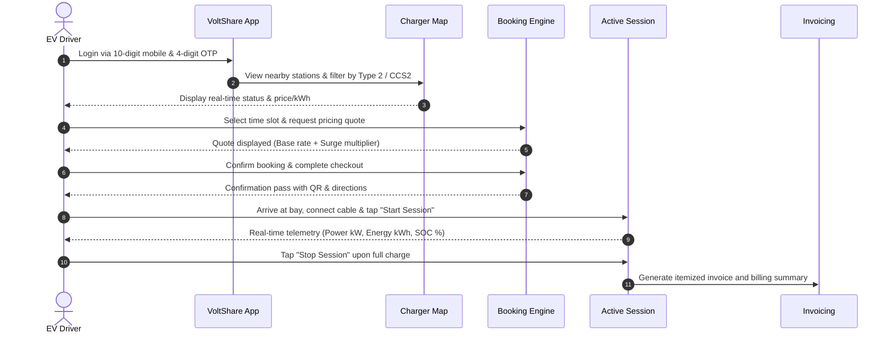
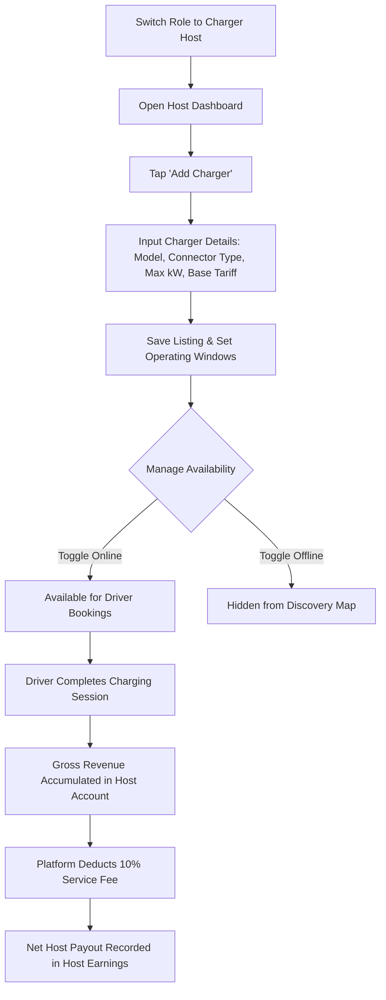
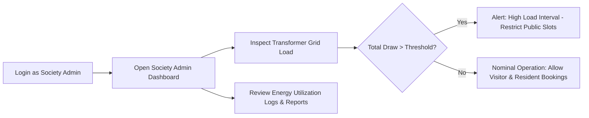
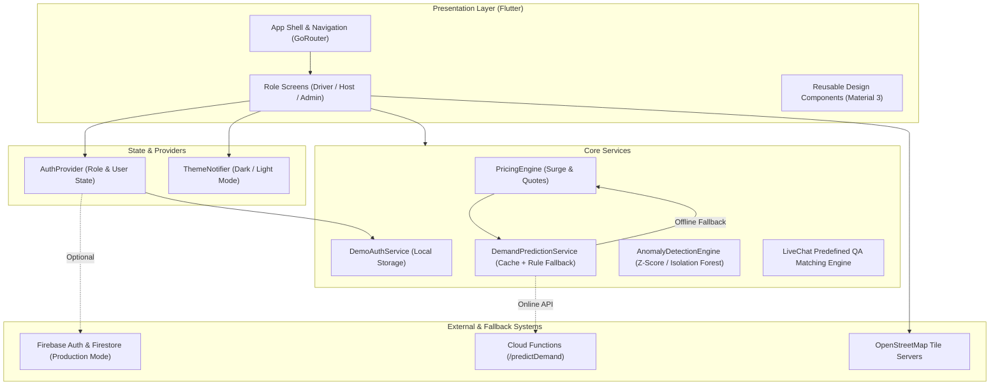

# VoltShare (vnest_app)

> **Peer-to-Peer EV Charging & Residential Energy Marketplace**  
> *Connecting EV drivers with private charger hosts and residential societies across India.*

[](https://flutter.dev)
[](https://dart.dev)
[](https://github.com/jahnavireddy18/Voltshare/actions/workflows/build_apk.yml)
[](https://github.com/jahnavireddy18/Voltshare/actions/workflows/build_web.yml)
[](LICENSE)

VoltShare is a cross-platform peer-to-peer (P2P) electric vehicle charging marketplace built with Flutter. It addresses urban charging infrastructure deficits by bridging two complementary groups: EV drivers seeking dependable, pre-bookable charging bays, and residential charger owners (hosts and apartment societies) whose charging stations sit idle throughout work hours. The platform features three distinct role-based experiences—**EV Driver**, **Charger Host**, and **Society Admin**—powered by client-side telemetry simulation, rule-based dynamic pricing, an automated live support assistant, and a flexible demonstration authentication system designed for zero-friction hackathon evaluations.

---

## ⚡ Hackathon & Demo Quick Access

To evaluate the application immediately on web or mobile without SMS carrier delays, VoltShare ships with a **Flexible Demo Mode** enabled by default (`--dart-define=AUTH_MODE=demo`):

| Parameter | Accepted Demo Values | Notes |
| :--- | :--- | :--- |
| **Mobile Number** | Any valid 10-digit Indian number (e.g., `9876543210`, `8765432109`, `+91 98765 43210`) | Auto-normalized to 10 numeric digits. |
| **Demo OTP** | **Any 4-digit numeric code** from `0000` to `9999` (e.g., `1234`, `0047`, `5678`) | No live SMS transmission required. |
| **Email & Password** | `demo@voltshare.app` / `123456` | Alternative credentials for password-based login forms. |
| **Role Switcher** | Switch between **Driver**, **Host**, and **Society Admin** | Directly switchable from the app bar profile menu. |

> **Security Disclosure**: Arbitrary 4-digit OTP acceptance is strictly an evaluation feature implemented in `DemoAuthService` to ensure evaluator independence from third-party SMS gateway downtime. In production builds (`--dart-define=AUTH_MODE=production`), real Firebase Phone Authentication with carrier SMS verification is enforced.

---

## Table of Contents

- [Problem Statement](#-problem-statement)
- [Proposed Solution](#-proposed-solution)
- [Why VoltShare?](#-why-voltshare)
- [Key Features & Implementation Status](#-key-features--implementation-status)
- [User Workflows](#-user-workflows)
- [Technology Stack](#-technology-stack)
- [System Architecture](#-system-architecture)
- [Repository Structure](#-repository-structure)
- [Installation and Local Setup](#-installation-and-local-setup)
- [Authentication and Demo Limitations](#-authentication-and-demo-limitations)
- [Build and Continuous Integration](#-build-and-continuous-integration)
- [Testing and Quality Assurance](#-testing-and-quality-assurance)
- [Screenshots and Demonstration Guide](#-screenshots-and-demonstration-guide)
- [Security, Privacy, and Limitations](#-security-privacy-and-limitations)
- [Future Roadmap](#-future-roadmap)
- [Impact and Sustainability](#-impact-and-sustainability)
- [Team and Acknowledgements](#-team-and-acknowledgements)
- [License](#-license)

---

## 📌 Problem Statement

Widespread adoption of electric vehicles in India faces two structural hurdles:

1. **For EV Drivers**: Public fast-charging stations are often concentrated along major highways or commercial corridors, leaving residential colonies, gated apartments, and suburban workplaces as charging deserts. Drivers endure range anxiety, queue uncertainty, and bay blockage by internal combustion vehicles ("ICE-ing").
2. **For Private Charger Owners & Residential Societies**: Millions of home and community EV wallbox chargers are utilized for only 2 to 4 hours per night. During working hours (8:00 AM – 6:00 PM), these private capital investments remain idle, generating zero economic return for owners while local transformer capacities operate under-utilized.

VoltShare proposes a marketplace structure to unlock private community charging capacity, turning parked residential chargers into a distributed, reserve-ahead charging network.

---

## 💡 Proposed Solution

VoltShare connects drivers, private hosts, and residential welfare associations (RWAs) through a unified Flutter application:

* **For EV Drivers**: Real-time charger discovery with interactive map filtering (Type 2 AC and CCS2 DC), time-slot booking, live session monitoring (battery %, power kW, energy kWh), in-app payment receipts, and automated support.
* **For Charger Hosts**: Comprehensive station onboarding, live status toggling (Online/Offline), custom rate configuration per kWh, operating hour scheduling, direct driver chat, and earnings tracking with net payout calculations (deducting a 10% platform fee).
* **For Society Admins**: High-level visibility into community charger clusters, transformer load headroom monitoring, aggregate daily energy delivered (kWh), and resident vs. visitor session auditing.

### Implementation Scope Matrix

| Capability Category | Fully Implemented in Codebase | Partially Implemented / Local Fallback | Planned for Future Releases |
| :--- | :--- | :--- | :--- |
| **Authentication** | Demo 10-digit mobile + arbitrary 4-digit OTP; SharedPreferences session persistence; role switching. | Firebase Phone & Email Auth (configured, requires active credentials). | Government ID (Aadhaar/DigiLocker) host KYC verification. |
| **Charger Discovery** | Interactive OpenStreetMap (`flutter_map`) with pin clustering, location search, and connector filtering. | Device GPS tracking (`geolocator`); fallback coordinate defaults. | Turn-by-turn navigation overlay with voice guidance. |
| **Slot Booking** | Date/slot picker, cost quotation, summary review, and booking confirmation lifecycle. | Local booking state management with demo mock stations. | Real-time OCPP hardware remote start lock/unlock relay. |
| **Session Telemetry** | Active charging telemetry screen: live power draw (kW), energy (kWh), battery gauge, elapsed time. | Client-side telemetry simulation and mathematical curve rendering. | Physical OCPP 1.6J WebSocket daemon integration with hardware meters. |
| **Pricing & Billing** | Dynamic pricing quote generator with surge multiplier; in-app checkout mockup; invoice PDF/summary screen. | Demand prediction fallback rule-engine; client-side payment flow. | Real Payment Gateway Webhook capture (Razorpay / Stripe / UPI intent). |
| **Support & Policies** | Live Support Chat with dual-tier keyword matching; crash-safe Report an Issue dialog; Terms & Privacy screens. | Offline ticket logging with floating confirmation SnackBar. | Remote helpdesk ticketing backend (Zendesk / Freshdesk API). |
| **Society Admin** | Overview dashboard, transformer capacity gauge, session logs, and society energy metrics. | Synthetic load calculations based on mock community chargers. | Physical multi-meter smart energy gateway telemetry ingestion. |

---

## ⭐ Why VoltShare?

1. **True Peer-to-Peer Multi-Role Model**: Rather than treating chargers as homogeneous commercial assets, VoltShare distinguishes between private host bays, community resident chargers, and public visitors.
2. **Adaptive Offline & Demo Resilience**: The application is architected so that evaluators and judges never hit a broken screen if backend or ML cloud endpoints are unreachable. Services like `DemandPredictionService` gracefully degrade to deterministic rule-based algorithms.
3. **Hardware-Aware Design**: Accommodates standard Indian EV charging specifications, including Type 2 (Mennekes AC 3.3 kW – 22 kW) and CCS2 DC fast charging up to 60 kW, complete with idle fee grace periods (15 minutes).
4. **Intelligent On-Device Support**: Built-in Live Chat uses a dual-tier keyword and trigger scoring engine that resolves 16 distinct domain topics without relying on paid third-party AI APIs or risking evaluation downtime.

---

## 📋 Key Features & Implementation Status

| Feature | Role / Actor | Description | Status | Source Location |
| :--- | :--- | :--- | :--- | :--- |
| **Demo Login & OTP** | All Roles | Validates any 10-digit Indian number + any 4-digit numeric OTP; persists session locally. | **Implemented** | [lib/core/services/demo_auth_service.dart](file:///c:/Users/jahnavi/OneDrive/Desktop/volt/Voltshare-main/lib/core/services/demo_auth_service.dart) |
| **Role-Based Routing** | Driver / Host / Admin | Dedicated entry points, shells, and permission guards for all 3 roles. | **Implemented** | [lib/core/router/app_router.dart](file:///c:/Users/jahnavi/OneDrive/Desktop/volt/Voltshare-main/lib/core/router/app_router.dart) |
| **Charger Discovery Map** | Driver | Leaflet/OpenStreetMap rendering via `flutter_map` with Type 2/CCS2 filters and price badges. | **Implemented** | [lib/screens/home/charger_map_screen.dart](file:///c:/Users/jahnavi/OneDrive/Desktop/volt/Voltshare-main/lib/screens/home/charger_map_screen.dart) |
| **Slot Booking & Checkout** | Driver | Multi-step booking flow with date, time slot, duration, cost quote, and confirmation. | **Implemented** | [lib/screens/booking/book_confirm_screen.dart](file:///c:/Users/jahnavi/OneDrive/Desktop/volt/Voltshare-main/lib/screens/booking/book_confirm_screen.dart) |
| **Live Session Telemetry** | Driver | Real-time monitoring of power (kW), delivered energy (kWh), SOC %, and "Stop Session" trigger. | **Implemented** | [lib/screens/session/active_session_screen.dart](file:///c:/Users/jahnavi/OneDrive/Desktop/volt/Voltshare-main/lib/screens/session/active_session_screen.dart) |
| **Trip Planner** | Driver | Long-distance EV trip route visualizer with station stops along the corridor. | **Implemented** | [lib/screens/trips/trip_planner_screen.dart](file:///c:/Users/jahnavi/OneDrive/Desktop/volt/Voltshare-main/lib/screens/trips/trip_planner_screen.dart) |
| **Charger Management** | Charger Host | Add, edit, and toggle charger listings; set base rates per kWh; configure operating days. | **Implemented** | [lib/screens/host/charger_form_screen.dart](file:///c:/Users/jahnavi/OneDrive/Desktop/volt/Voltshare-main/lib/screens/host/charger_form_screen.dart) |
| **Host Earnings & Payouts** | Charger Host | Financial dashboard tracking gross charging revenue, completed sessions, and net payout. | **Implemented** | [lib/screens/host/host_dashboard_screen.dart](file:///c:/Users/jahnavi/OneDrive/Desktop/volt/Voltshare-main/lib/screens/host/host_dashboard_screen.dart) |
| **Host-Driver Messaging** | Driver & Host | Mock 1-on-1 slot chat for arrival coordination and bay access directions. | **Implemented** | [lib/screens/host/host_chat_screen.dart](file:///c:/Users/jahnavi/OneDrive/Desktop/volt/Voltshare-main/lib/screens/host/host_chat_screen.dart) |
| **Society Admin Dashboard** | Society Admin | Transformer capacity gauge, aggregate consumption metrics, and resident charging logs. | **Implemented** | [lib/screens/admin/society_admin_dashboard_screen.dart](file:///c:/Users/jahnavi/OneDrive/Desktop/volt/Voltshare-main/lib/screens/admin/society_admin_dashboard_screen.dart) |
| **Live Chat Assistant** | All Roles | Predefined QA system resolving 16 functional topics with weighted keyword matching. | **Implemented** | [lib/screens/support/live_chat_screen.dart](file:///c:/Users/jahnavi/OneDrive/Desktop/volt/Voltshare-main/lib/screens/support/live_chat_screen.dart) |
| **Help & Issue Reporting** | All Roles | Role-segmented FAQs, email desk sheets, and crash-safe bounded Report an Issue dialog. | **Implemented** | [lib/screens/profile/help_support_screen.dart](file:///c:/Users/jahnavi/OneDrive/Desktop/volt/Voltshare-main/lib/screens/profile/help_support_screen.dart) |
| **Legal Documentation** | All Roles | Comprehensive Indian jurisdiction-aligned Terms of Service and Privacy Policy screens. | **Implemented** | [lib/screens/profile/terms_of_service_screen.dart](file:///c:/Users/jahnavi/OneDrive/Desktop/volt/Voltshare-main/lib/screens/profile/terms_of_service_screen.dart) |
| **ML Demand Model** | Backend / Cloud | Scikit-learn GradientBoostingRegressor pipeline with synthetic dataset generator. | **Offline / Cloud** | [ml/train_demand_model.py](file:///c:/Users/jahnavi/OneDrive/Desktop/volt/Voltshare-main/ml/train_demand_model.py) |
| **Hardware OCPP Server** | Backend | Protocol models and data contract for OCPP 1.6J/2.0 JSON WebSocket handlers. | **Architected** | [lib/core/services/ocpp_service.dart](file:///c:/Users/jahnavi/OneDrive/Desktop/volt/Voltshare-main/lib/core/services/ocpp_service.dart) |

---

## 🔄 User Workflows

### 1. EV Driver Workflow (Discovery to Completion)



### 2. Charger Host Workflow (Onboarding to Payout)



### 3. Society Admin Workflow (Load Monitoring)



---

## 🛠️ Technology Stack

| Layer | Technology | Version / Constraint | Verified Usage & Purpose |
| :--- | :--- | :--- | :--- |
| **Framework** | **Flutter** | `Channel stable` | Cross-platform UI toolkit compiling to native Android APK and Web. |
| **Language** | **Dart** | `^3.12.0` | Strong-mode typed application logic, models, and async streams. |
| **Navigation** | **GoRouter** | `^17.3.0` | Declarative deep-linking with path parameters, route guards, and animated transitions. |
| **Mapping & GIS** | **flutter_map & latlong2** | `^8.3.0` / `^0.9.1` | OpenStreetMap tile renderer with custom station markers and interactive coordinate pins. |
| **Geolocation** | **geolocator** | `^14.0.2` | Mobile device GPS coordinate lookup and distance calculations. |
| **State & Storage** | **shared_preferences** | `^2.5.5` | Client-side persistence for auth tokens, active role, and demo session state. |
| **Styling & Fonts** | **google_fonts** | `^8.1.0` | Typography using *Sora*, *Manrope*, *Plus Jakarta Sans*, and *JetBrains Mono*. |
| **Animations** | **flutter_animate** | `^4.5.2` | Fluid staggered fade, slide, and entrance micro-animations. |
| **Data Viz** | **fl_chart** | `^0.70.2` | Telemetry curves, battery percentage gauges, and transformer load charts. |
| **Cloud Services** | **Firebase Core / Auth / Firestore** | `^3.8.1` / `^5.5.0` / `^5.6.0` | Optional production cloud synchronization and auth backend. |
| **ML Engine** | **Python / scikit-learn** | `Python 3.10+` / `scikit-learn 1.3+` | GradientBoostingRegressor training script (`ml/train_demand_model.py`) for dynamic pricing. |
| **Cloud Functions** | **Firebase Functions (Python)** | `firebase-functions` | Serverless Python endpoint hosting the demand prediction model (`functions/main.py`). |

---

## 🏗️ System Architecture

VoltShare uses a modular service-oriented architecture separating the presentation layer from business logic and telemetry feeds:



---

## 📂 Repository Structure

```text
Voltshare-main/
├── .github/
│   └── workflows/
│       ├── build_apk.yml           # GitHub Actions workflow: Android Release APK build & tests
│       └── build_web.yml           # GitHub Actions workflow: Flutter Web production build
├── android/                        # Android native platform runner and Gradle wrapper
├── functions/                      # Serverless Firebase Cloud Functions in Python
│   ├── main.py                     # /predictDemand endpoint handling demand scoring
│   ├── model/                      # Serialized ML model artifact (demand_model.joblib)
│   └── requirements.txt            # Python dependencies for Cloud Functions
├── ios/                            # iOS native platform runner configuration
├── lib/
│   ├── core/
│   │   ├── config/                 # API endpoints, auth mode flags, constants
│   │   ├── enums/                  # UserRole, BookingStatus, SessionStatus, ConnectorType
│   │   ├── models/                 # Telemetry, pricing, user, booking, charger models
│   │   ├── providers/              # AuthProvider, session controllers
│   │   ├── router/                 # AppRouter definition with all registered GoRoutes
│   │   ├── services/               # Pricing engine, demo auth, telemetry simulator
│   │   └── theme/                  # Color tokens, typography, dark/light themes
│   ├── screens/
│   │   ├── admin/                  # SocietyAdminDashboardScreen (transformer load, logs)
│   │   ├── auth/                   # LoginScreen, OtpVerificationScreen, RoleSelectionScreen
│   │   ├── booking/                # BookConfirmScreen, BookingDetailsScreen, BookingHistoryScreen
│   │   ├── carplay/                # CarDashboardScreen (in-car display mockup)
│   │   ├── energy/                 # GridLoadDashboardScreen
│   │   ├── home/                   # ChargerMapScreen, ChargerDetailsScreen
│   │   ├── host/                   # HostDashboardScreen, ChargerFormScreen, HostChatScreen
│   │   ├── onboarding/             # OnboardingScreen
│   │   ├── profile/                # ProfileScreen, HelpSupportScreen, Terms, Privacy
│   │   ├── session/                # ActiveSessionScreen, SessionSummaryScreen
│   │   ├── shell/                  # AppShell (Bottom navigation bar)
│   │   ├── support/                # LiveChatScreen (QA assistant)
│   │   └── trips/                  # TripPlannerScreen (long-distance corridor planner)
│   ├── widgets/                    # Buttons, input fields, badges, cards
│   ├── firebase_options.dart       # Firebase platform configuration
│   └── main.dart                   # Application entry point & theme initialization
├── ml/                             # Machine learning experiments and training scripts
│   ├── generate_synthetic_data.py  # Synthetic charging dataset generation script
│   ├── train_demand_model.py       # Scikit-learn GradientBoostingRegressor training
│   └── requirements.txt            # Python requirements for ML training
├── test/
│   ├── demo_auth_test.dart         # Unit tests: Phone validation, 4-digit OTP, sessions
│   └── widget_test.dart            # Flutter widget smoke tests
├── web/                            # Web platform index.html, manifest, and favicons
├── analysis_options.yaml           # Linting rules (package:flutter_lints)
├── pubspec.yaml                    # Dart package configuration and dependencies
└── README.md                       # Complete project technical documentation
```

---

## 🚀 Installation and Local Setup

### Prerequisites

Ensure the following tools are installed on your host system:

* **Flutter SDK**: `3.19.0` or newer (`stable` channel recommended).
* **Dart SDK**: `^3.12.0` (included with Flutter).
* **Java Development Kit (JDK)**: JDK 17 (required for Gradle Android builds).
* **Git**: Command-line client.
* **Target Environment**: Android Studio / Emulator, Chrome browser, or a connected physical Android device.

### 1. Clone the Repository

```bash
git clone https://github.com/jahnavireddy18/Voltshare.git
cd Voltshare
```

### 2. Install Flutter Dependencies

Fetch all packages defined in `pubspec.yaml`:

```bash
flutter pub get
```

### 3. Run Static Code Analysis & Tests

Verify code quality and execute automated unit tests:

```bash
# Run Dart analyzer
flutter analyze

# Run unit and widget tests
flutter test --reporter expanded
```

### 4. Launch Application in Demo Mode (Recommended)

To run the application with **Flexible Demo Authentication** on an emulator or browser:

```bash
# Run on Chrome (Web)
flutter run -d chrome --dart-define=AUTH_MODE=demo

# Run on connected Android device / emulator
flutter run -d android --dart-define=AUTH_MODE=demo
```

### 5. Launch in Production Firebase Mode (Optional)

If connecting to an active Firebase project with real carrier SMS OTP:

```bash
flutter run --dart-define=AUTH_MODE=production
```

> **Note on Configuration & Secrets**: VoltShare does not commit sensitive API keys or service account credentials. When building for production, place your verified `google-services.json` in `android/app/` and update `lib/firebase_options.dart` with your target Firebase credentials.

---

## 🔒 Authentication and Demo Limitations

VoltShare explicitly discloses its dual-mode authentication behavior to ensure complete transparency during technical evaluations:

1. **Demo Mode (Default: `--dart-define=AUTH_MODE=demo`)**:
   * Accepts **any valid 10-digit Indian mobile number** starting with digits `6`, `7`, `8`, or `9`.
   * Accepts **any 4-digit numeric code** from `0000` to `9999` (including codes with leading zeros like `0047`).
   * Saves the generated session locally in `SharedPreferences` under a deterministic identifier (`demo_<normalized_phone>`).
   * **Limitation**: This does not verify ownership of the phone number. It is an intentional design choice to guarantee that evaluators and hackathon judges can review all role-based features without cellular network dependency or SMS gateway latency.
2. **Production Mode (`--dart-define=AUTH_MODE=production`)**:
   * Invokes `FirebaseAuth.instance.verifyPhoneNumber`.
   * Enforces carrier-grade SMS OTP delivery and server-side verification before generating a Firebase user session.
   * Requires configured SHA-1 fingerprints in the Google Cloud Console.

---

## ⚙️ Build and Continuous Integration

VoltShare utilizes GitHub Actions for automated continuous integration on every commit and pull request to the `main` branch.

### 1. Android Release APK Workflow (`.github/workflows/build_apk.yml`)
* **Trigger Conditions**: Pushes to `main`, pull requests to `main`, or manual `workflow_dispatch`.
* **Build Steps**:
  1. Checks out repository via `actions/checkout@v4`.
  2. Sets up JDK 17 (`temurin` distribution).
  3. Sets up Flutter `stable` channel via `subosito/flutter-action@v2`.
  4. Runs environment verification (`flutter doctor -v`).
  5. Installs dependencies (`flutter pub get`).
  6. Executes automated unit tests (`flutter test --reporter expanded`).
  7. Compiles release bundle (`flutter build apk --release`).
  8. Uploads build artifact **`app-release`** (`build/app/outputs/flutter-apk/app-release.apk`) with a 14-day retention window.

### 2. Flutter Web Workflow (`.github/workflows/build_web.yml`)
* **Trigger Conditions**: Pushes to `main` or manual `workflow_dispatch`.
* **Build Steps**:
  1. Installs Flutter `stable`.
  2. Installs dependencies (`flutter pub get`).
  3. Compiles production web bundle (`flutter build web --release`).
  4. Uploads build artifact **`voltshare-web`** (`build/web/`).

> **Hosting Notice**: The Flutter Web workflow validates web compilation and produces deployable static assets. Downloading the `voltshare-web` artifact provides the static files ready for deployment on Vercel, Firebase Hosting, Netlify, or AWS S3.

---

## 🧪 Testing and Quality Assurance

VoltShare maintains automated unit tests and strict static analysis:

* **Unit & Logic Tests (`test/demo_auth_test.dart`)**:
  * Phone number format validation (verifies 10-digit Indian regex, rejects alphanumeric/short inputs).
  * Phone normalization (strips `+91`, leading `0`, spaces, and dashes).
  * 4-digit numeric OTP validation (accepts `0000`–`9999`, preserves leading zeros, rejects non-numeric or malformed strings).
  * Session lifecycle (initial demo creation, returning user persistence, and clean sign-out).
  * Role switching state consistency across User, Host, and Admin roles.
* **Widget Smoke Tests (`test/widget_test.dart`)**:
  * Verifies root widget tree mounting and MaterialApp instantiation.
* **Static Analysis**:
  * Complies with `package:flutter_lints/flutter.yaml` conventions.
  * Verified in CI on every push to `origin/main`.

To run the full test suite locally:

```bash
flutter test
```

---

## 📸 Screenshots and Demonstration Guide

VoltShare provides a high-contrast dark/light design system built with Google Fonts (*Sora*, *Manrope*, and *JetBrains Mono*) and smooth micro-animations.

### Visual Architecture & Capture Targets

```
┌─────────────────────────┐  ┌─────────────────────────┐  ┌─────────────────────────┐
│     Charger Map         │  │   Active Telemetry      │  │    Host Dashboard       │
│  [ Interactive Map ]    │  │  [ SOC Battery Gauge ]  │  │  [ Revenue Summary ]    │
│  • Type 2 / CCS2 filter │  │  • Real-time kW draw    │  │  • Active Bays (Online) │
│  • Station Price Badges │  │  • Delivered Energy kWh │  │  • Pricing Configuration│
│  • One-tap Reservation  │  │  • Stop Session Button  │  │  • Host Earnings Tab    │
└─────────────────────────┘  └─────────────────────────┘  └─────────────────────────┘
        Target Screen:              Target Screen:              Target Screen:
   charger_map_screen.dart     active_session_screen.dart   host_dashboard_screen.dart
```

### Recommended 5-Minute Evaluator Tour

For judges testing the application:

1. **Authentication**: Launch the app, enter any 10-digit number (e.g., `9876543210`), and enter OTP `1234`. Tap **Verify & Continue**.
2. **Explore Discovery**: On the home **Charger Map**, pan the interactive OpenStreetMap view, tap filter chips (e.g., *Fast DC*, *Type 2 AC*), and inspect station details and tariff information.
3. **Simulate a Session**: Select any station, tap **Book Slot**, review the cost quotation, and navigate to **Active Session** to observe the live animated telemetry gauge (kW, kWh, battery percentage).
4. **Evaluate Host Experience**: Tap the role indicator in the top right, switch to **Charger Host**, and view **Host Dashboard**. Tap **Add Charger** to inspect charger onboarding or **Host Earnings** to review revenue calculations.
5. **Evaluate Society Admin**: Switch role to **Society Admin** to inspect community transformer load monitoring and energy distribution metrics.
6. **Test Live Support**: Navigate to **Help & Support > Live Support Chat** and ask questions such as *"How do I download my invoice?"*, *"What is the charging cost per kWh?"*, or *"Can I cancel my slot?"* to evaluate the built-in QA matching engine.

---

## 🛡️ Security, Privacy, and Limitations

VoltShare adheres to transparent disclosure regarding its current architecture:

1. **Demonstration Mode**: Arbitrary OTP validation is active by default. It must not be deployed in production environments handling real customer payments without passing `--dart-define=AUTH_MODE=production`.
2. **Payment Processing**: Checkout screens simulate order creation and payment authorization. Real payment gateway webhooks (such as Razorpay or Stripe) require backend infrastructure integration before processing monetary transactions.
3. **Ticketing & Backend Support**: The "Report an Issue" form validates input and logs issue tickets locally with floating user feedback; it does not currently transmit tickets to an external ticketing platform (e.g., Zendesk).
4. **Physical Charger Telemetry**: Telemetry on the Active Session screen is rendered via real-time mathematical simulation models. Direct hardware actuation requires live OCPP WebSocket gateways.

---

## 🗺️ Future Roadmap

* [ ] **Phase 1: Production Authentication & Host KYC**
  * Integrate Aadhaar/DigiLocker verification for Charger Hosts.
  * Enforce strict production Firebase Phone Authentication with reCAPTCHA.
* [ ] **Phase 2: Payment Gateway & Escrow**
  * Razorpay / UPI Intent SDK integration for Indian domestic cards and UPI handles.
  * Automated host payout disbursements via RazorpayX / IMPS.
* [ ] **Phase 3: Hardware OCPP 1.6J/2.0 Gateway**
  * WebSocket backend daemon supporting `RemoteStartTransaction` and `RemoteStopTransaction`.
  * Physical energy meter pulse counting and hardware fault alerts.
* [ ] **Phase 4: Turn-by-Turn Navigation**
  * In-app turn-by-turn routing to parking bays with basement offline navigation beacons.

---

## 🌿 Impact and Sustainability

By enabling private charger sharing, VoltShare aims to:

* **Reduce Capital Duplication**: Utilize existing residential wallboxes instead of relying solely on capital-intensive public land acquisitions and dedicated commercial grid lines.
* **Encourage Renewable Utilization**: Facilitate daytime charging when solar generation in residential microgrids is highest.
* **Promote Equitable Urban EV Adoption**: Enable apartment dwellers without dedicated parking stalls to purchase EVs with confidence, knowing community neighbor bays can be booked in advance.

---

## 👥 Team and Acknowledgements

* **Development Team**: **LazyCoders**
* **Project Repository**: [https://github.com/jahnavireddy18/Voltshare.git](https://github.com/jahnavireddy18/Voltshare.git)
* **Built With**: Flutter community open-source libraries (`flutter_map`, `go_router`, `google_fonts`, `flutter_animate`, `fl_chart`).

---

## 📄 License

This project is currently developed as an open-source demonstration application under the **MIT License**. See [LICENSE](LICENSE) for details.
